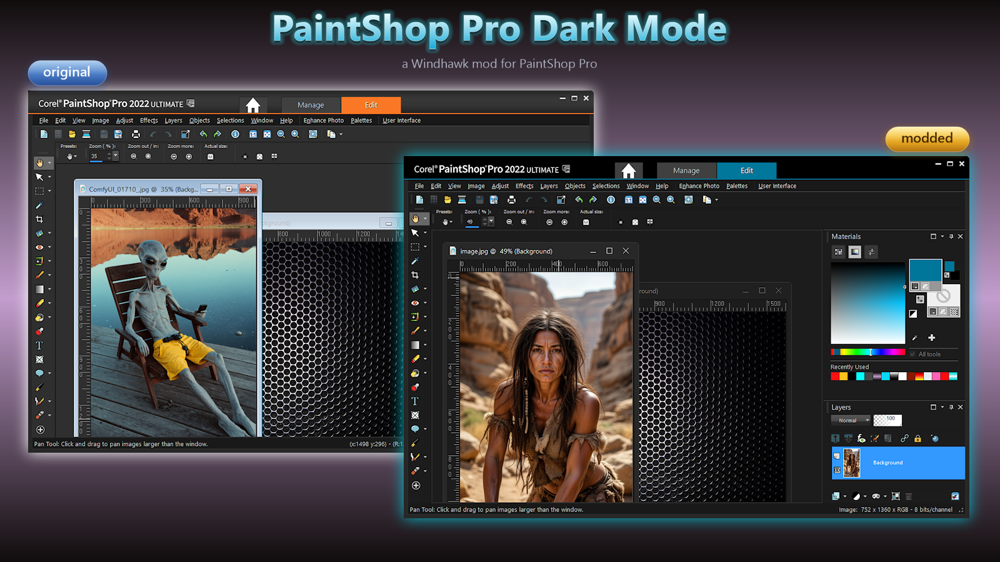

# PaintShop Pro Dark Mode

A [Windhawk](https://windhawk.net) mod that makes Corel PaintShop Pro really dark: darker interface, black title bar, your own accent color and dark image windows.

## Why

PaintShop Pro has a dark theme, but it is not really dark: the surfaces are a medium gray, the title bar is gray with an orange tab, and the image windows in the workspace keep a light blue-gray frame that looks like Windows XP or 7. This mod goes the rest of the way.

## What it changes

- **Interface darkness:** the dark gray surfaces (tool bars, tool column, palettes, tool options bar, dialogs, the area around the color wheel) get darker. The level is a setting, and the hue stays the same.
- **Title bar:** the title bar of the main window gets a color of your choice, black by default.
- **Accent color:** the orange of the "Edit" tab and of the line below the title bar can be replaced by any color.
- **Image windows:** the frames of the image windows (MDI child windows) are painted dark: title bar, border, icon, title text, minimize, maximize and close buttons with hover and pressed states, and minimized image windows. Maximized image windows are left to Windows.
- **Start tiles (optional):** hides the eight learning tiles and the hint text in the middle of the empty workspace.
- **Flash fix (optional):** when you switch between images, PaintShop Pro rebuilds the drop-down lists in the tool options bar. For a few frames their selection fields flash white; the fix paints that field dark instead.

Everything is done by re-coloring while PaintShop Pro draws, so no theme files, program files or system settings are touched, and only PaintShop Pro is affected.

## Install

1. Install [Windhawk](https://windhawk.net).
2. Search for **PaintShop Pro Dark Mode** in the Windhawk catalog and click **Install**.
3. Restart PaintShop Pro once, so that the interface darkness, title bar and accent color apply.

To install from this repository instead, click **Create a new mod** in Windhawk, replace the whole content of the editor with [`psp-dark-mdi-frames.wh.cpp`](psp-dark-mdi-frames.wh.cpp), and click **Compile Mod**.

## Settings

Colors are hex codes, for example `282828` or `#282828`. A value that cannot be read falls back to its default. The frame colors, the layout and the flash fix apply right away; the interface darkness, the title bar color and the accent color apply after restarting PaintShop Pro.

| Setting | Default |
| --- | --- |
| Interface darkness | 60 (percent of the original brightness, 100 = unchanged) |
| Title bar color | `000000` (empty = original gray) |
| Accent color | empty (original orange) |
| Hide the start tiles | off |
| Title bar, active / inactive (image windows) | `282828` / `202020` |
| Title text, active / inactive | `ECECEC` / `828282` |
| Outer border line | `3A3A3A` |
| Thin line around the image area | `101010` |
| Button symbols, active / inactive | `E4E4E4` / `787878` |
| Button hover / pressed | `464646` / `5A5A5A` |
| Close button hover / pressed | `C42B1C` / `961E14` |
| Distance between the caption buttons | 29 px (at 100% scaling) |
| Size of the button symbols | 10 px (at 100% scaling) |
| Fix white flash in the tool options bar | on |
| Color used instead of white | `3C3C3C` |

## Compatibility

Tested with PaintShop Pro 2022 on Windows 11 (build 26100). Other versions may work but have not been tested. Some parts of the interface are recognized by their size and color, so a different version may look different in places. If something looks wrong, disable the mod in Windhawk and restart PaintShop Pro: the original look comes back.

## License

[MIT](LICENSE)
